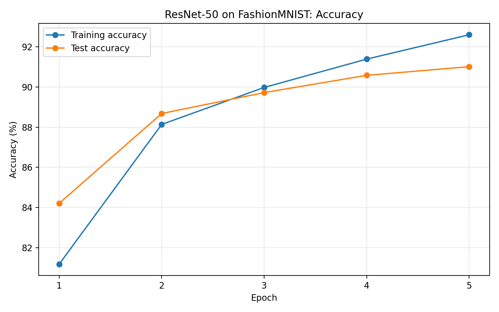
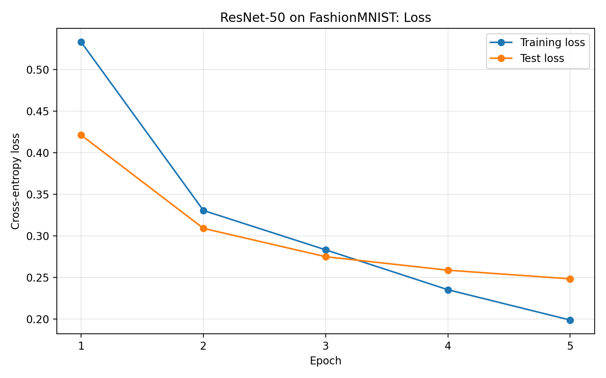

# ResNet-50 on FashionMNIST with PyTorch

A from-scratch implementation of ResNet-50 in PyTorch, trained on FashionMNIST to explore residual learning for grayscale image classification.

## Overview

This project implements ResNet-50 using custom PyTorch modules and bottleneck residual blocks. The model was trained from random initialization without pretrained weights.

## Architecture

- Architecture: ResNet-50
- Residual stages: [3, 4, 6, 3] bottleneck blocks
- Input: 1-channel grayscale images (28 × 28)
- Initial convolution: 7 × 7, stride 1
- Max pooling: 3 × 3, stride 1
- Output classes: 10
- Total parameters: 23,522,250

The initial convolution and max-pooling strides are adapted for small input images.

## Dataset and preprocessing

FashionMNIST was loaded using `torchvision`.

- Training examples: 60,000
- Test examples: 10,000
- Preprocessing: tensor conversion and normalization
- Normalization: mean 0.5, standard deviation 0.5
- Normalized pixel range: [-1, 1]

## Training configuration

| Setting | Value |
|---|---|
| Initialization | Random |
| Optimizer | SGD |
| Learning rate | 0.01 |
| Momentum | 0.9 |
| Weight decay | 0.0005 |
| Loss function | Cross-entropy |
| Training batch size | 64 |
| Evaluation batch size | 256 |
| Epochs | 5 |
| Device used for recorded run | CPU |
| Logging | TensorBoard |

## Results

Results from the recorded five-epoch run:

| Epoch | Training accuracy | Training loss | Test accuracy | Test loss |
|---:|---:|---:|---:|---:|
| 1 | 81.18% | 0.5328 | 84.21% | 0.4212 |
| 2 | 88.14% | 0.3306 | 88.68% | 0.3091 |
| 3 | 89.98% | 0.2833 | 89.72% | 0.2750 |
| 4 | 91.39% | 0.2353 | 90.58% | 0.2588 |
| 5 | 92.60% | 0.1989 | 91.01% | 0.2484 |

### Accuracy



### Loss



Test accuracy reached 91.01% by epoch 5, while test loss decreased throughout the run. Training was stopped after five epochs, while performance was still improving; therefore, this result does not represent the model's established maximum performance.

## Running the project

### 1. Clone the repository

```bash
git clone https://github.com/Rajesh-code11/fashionmnist-resnet50-pytorch.git
cd fashionmnist-resnet50-pytorch
```

### 2. Create a virtual environment

```powershell
python -m venv .venv
.\.venv\Scripts\Activate.ps1
```

### 3. Install dependencies

```powershell
pip install -r requirements.txt
```

### 4. Run training

```powershell
python src/exp4.py
```

The script downloads FashionMNIST if necessary, initializes a new model, trains for five epochs, prints the metrics, and writes TensorBoard logs to `runs/resnet50_experiment`.

**Note:** Running the script starts training from scratch; it does not resume from saved weights. Training time depends on your hardware.

### 5. View TensorBoard logs

After training, run:

```powershell
tensorboard --logdir runs/resnet50_experiment
```

Open the local URL printed in the terminal.

## Project structure

```text
fashionmnist-resnet50-pytorch/
├── src/
│   └── exp4.py
├── results/
│   ├── accuracy.png
│   ├── loss.png
│   └── training_results.csv
├── .gitignore
├── README.md
└── requirements.txt
```

## Limitations

- Training was limited to five epochs because of computational cost.
- The model was still improving at the final epoch.
- The test set was evaluated after every epoch. It was therefore not reserved exclusively for a single final evaluation, which limits the strength of the final performance claim.
- This is an initial experiment, not a controlled comparison with other architectures.

## Future work

- Use a separate validation set for model selection.
- Evaluate the test set only after training and model selection are complete.
- Investigate longer training and learning-rate schedules.
- Analyze per-class performance and a confusion matrix.
- Compare architectures under matched settings and multiple random seeds.

## License

No license has been selected yet.
